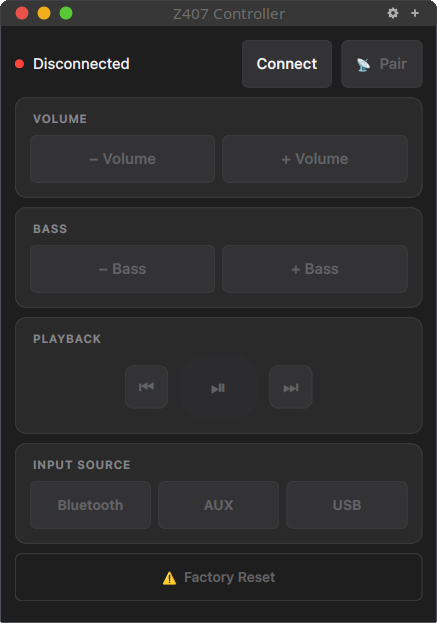
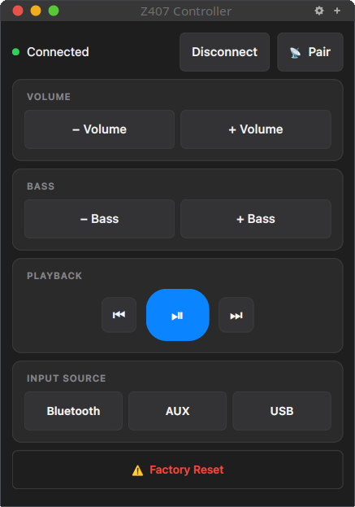

# Logitech Z407 Controller

Control your Logitech Z407 speakers over BLE (Bluetooth Low Energy) from Linux. This application replaces the physical wireless dial remote by implementing the same BLE GATT protocol.

## Screenshots

| Before connecting | Connected |
|:-----------------:|:---------:|
|  |  |

To start, click on **Connect**.

## Features

- **GUI**: Control panel with real-time status updates and an explicit Connect button
- **Volume and bass**: +/- buttons
- **Playback and input switching**: Play/pause, next/prev, Bluetooth / AUX / USB
- **Bluetooth pairing**: Trigger pairing mode so phones, tablets, laptops, etc. can pair with the speaker
- **Auto-reconnection**: Keeps the BLE connection alive with exponential backoff and adapter reset

## Installation

```bash
git clone <repo-url> z407-controller
cd z407-controller

# Install `z407-gui` and `z407-cli` into ~/.local/bin (creates the `z407` conda env if needed)
make install
```

Make sure `~/.local/bin` is on your `PATH`.

## Usage

```bash
z407-gui
```

Click **Connect** to connect to the speaker. All other controls stay disabled until the connection is established.

The control panel provides:

- **Connect / Disconnect**: Connects to the speaker, cancels a connection attempt, or disconnects
- **Pair**: One-click pairing mode, next to the Connect button
- **Volume** and **Bass**: +/- buttons (hold to repeat). The speaker does not report its levels, so no level is shown
- **Playback**: Play/pause, next/prev track
- **Input**: Bluetooth / AUX / USB toggle buttons
- **Factory Reset**: Confirmation-protected reset button

### Bluetooth Pairing Workflow

The Z407 speaker supports two independent Bluetooth connections:

1. **BLE (this app)**: Control channel for volume, input switching, and pairing mode
2. **BT Classic A2DP**: Audio channel for standard Bluetooth audio streaming

To pair a new audio device:

1. Run `z407-gui` and click **Connect**
2. Click **Pair**; the speaker enters discoverable mode (LED blinks, chime plays)
3. Open Bluetooth settings on your device (phone, tablet, etc.)
4. Select "Logitech Z407" to pair
5. Audio automatically streams to the speaker

## BLE Permissions

On Linux, BLE access may require elevated permissions:

```bash
# Option 1: Add capabilities to the Python executable
sudo setcap 'cap_net_raw,cap_net_admin+eip' $(which python3)

# Option 2: Run with sudo (not recommended for GUI)
sudo z407-gui
```

## Development

```bash
make dev    # create the conda env, install in editable mode, and launch the GUI
make test   # run tests
make lint   # run ruff
```

## Acknowledgements

The BLE protocol is based on the reverse engineering work by [freundTech](https://github.com/freundTech/logi-z407-reverse-engineering) and [androrama](https://github.com/androrama/Logitech-Z407-Remote-Control-Web-App---Linux).

## License

MIT
